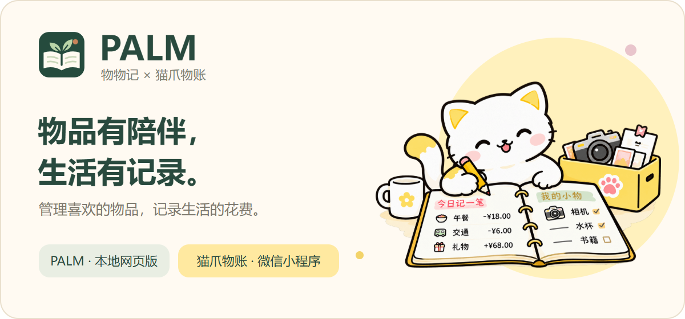
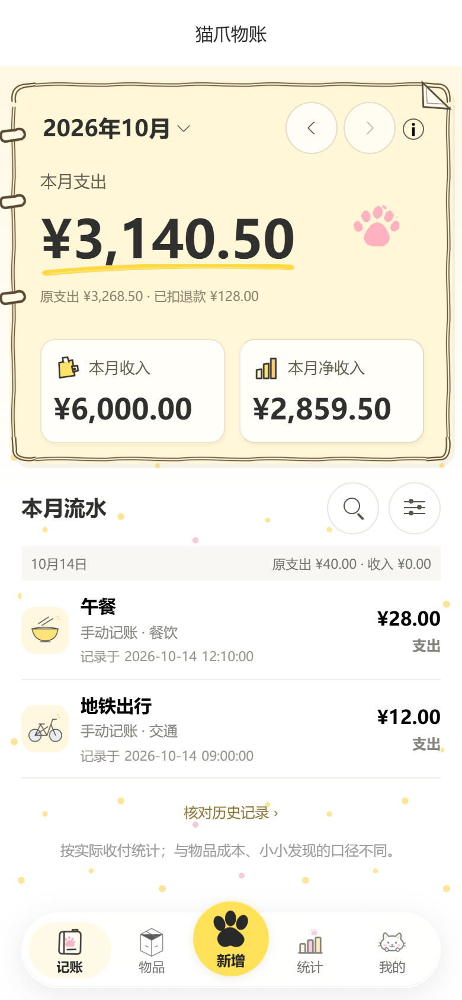
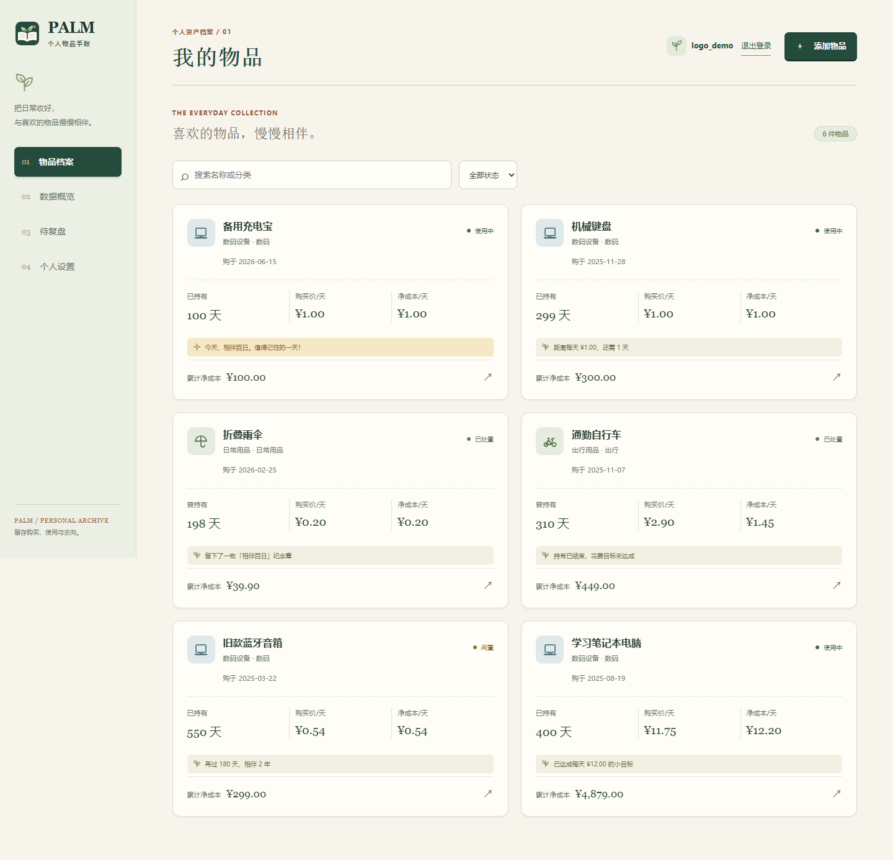

  

<h1 align="center">PALM／物物记 · 猫爪物账</h1>

<strong>管理喜欢的物品，记录生活的花费。</strong>

在电脑上整理物品的完整故事，也在微信里随手记下每一笔生活。

  <a href="#体验猫爪物账">微信小程序体验</a> ·
  <a href="https://github.com/HHH0825/Personal-Asset-Lifecycle-Manager-PALM/releases">Windows 下载</a> ·
  <a href="docs/user-guide.md">网页版使用说明</a> ·
  <a href="wechat/README.md">小程序源码与文档</a> ·
  <a href="https://github.com/HHH0825/Personal-Asset-Lifecycle-Manager-PALM/issues">反馈与建议</a>

  
  

## 选择适合你的记录方式

| | PALM／物物记 | 猫爪物账 |
|---|---|---|
| 场&nbsp;景 | 电脑上整理物品、维护完整档案 | 手机上管理物品、记录日常收支 |
| 使&nbsp;用 | Windows 安装，或本地启动后用浏览器访问 | 微信「搜一搜」搜索 **猫爪物账** |
| 功&nbsp;能 | 物品生命周期、日均成本、费用分析与月度回顾 | 物品档案、日均成本、记账统计、订阅／分期与月度小报 |
| 存&nbsp;储 | 本机数据库与照片目录 | 独立云端后端与照片存储 |
| 源&nbsp;码 | 仓库根目录 | [`wechat/`](wechat/README.md) |

**两个版本的账户与数据独立，不会自动同步。** 小程序可以直接体验；使用源码搭建自己的服务，需要配置自己的微信账号和云环境。

## 体验猫爪物账

**打开微信 → 搜一搜 → 输入「猫爪物账」→ 进入小程序。**

  

给喜欢的小物建一份档案，也给生活的收支留下一点记录。暖白纸面、浅黄点缀和小猫插画，让日常整理多一点轻松。

- **收好每件小物**：照片、分类、搜索、收纳位置与使用状态，找到自己拥有的东西。
- **看见物品的陪伴**：持有天数、维修与处置记录、日均净成本，了解每件物品的使用与花费。
- **记清生活的收支**：记录收入、支出与退款，通过日历和分类统计回看花费。
- **整理长期安排**：管理订阅与分期付款，回顾每月的物品收藏和收支小报。
- **按需要继续扩展**：账本、预算及部分个性化能力按当前账户权益开放，具体以小程序内说明为准。

  
  
  

物品档案 · 日常记账 · 收支统计。预览使用当前界面源码和虚构数据离线渲染，并非真机截图；点击可查看原图。

搜索图用于手动搜索指引。线上功能以微信内实际发布版本为准；尚未发布的源码调整见[小程序更新说明](wechat/README.md#源码更新与发布状态)。

## PALM／物物记：在电脑上整理物品的故事

PALM 是一款本地运行的个人物品资产生命周期管理工具，记录物品从 **购买 → 使用 → 维修 → 闲置 → 处置** 的完整过程。

  

- **完整物品档案**：管理购买信息、照片、状态与维修、处置记录。
- **日均使用成本与资产统计**：查看持有天数、日均花费、分类分布和费用变化。
- **月度回顾与规则提示**：回看物品的变化，留意保修、闲置和费用情况；此类分析基于规则，不依赖 AI 服务。
- **回收站与备份**：误删物品可在保留期内恢复，数据留在本机，备份与升级方法见文档。

### 开始使用网页版

- **Windows 安装版**：从 [Releases](https://github.com/HHH0825/Personal-Asset-Lifecycle-Manager-PALM/releases) 下载；操作步骤见[安装说明](packaging/windows/README.md)。
- **源码运行**：Windows 双击[启动 PALM.bat](<启动 PALM.bat>)，首次运行会自动配置环境；也可安装 `requirements-lock.txt` 中的依赖后运行 `python app.py`。

启动后访问 <http://127.0.0.1:5000>，关闭启动终端即可停止服务。网页版运行环境为 Python 3.10+、Flask 与 SQLite。

## 关于这个 Vibe Coding 项目

这是一个以 **Vibe Coding** 方式持续打磨的个人项目，在 AI 协作中把想法逐步变成可使用的工具。欢迎体验猫爪物账、试用 PALM，也欢迎把真实使用中的问题和想法告诉我。

你可以通过 [GitHub Issues](https://github.com/HHH0825/Personal-Asset-Lifecycle-Manager-PALM/issues) 提交问题或建议。反馈时附上**使用的版本、设备／系统、操作步骤、预期结果与实际表现**，会更容易定位问题；截图请遮挡个人资料、账目和其他敏感信息。

如果这个项目对你有帮助，也欢迎点一个 Star，让它被更多有相同需求的人看到。

## 文档与开发

- **本地网页版**：[使用说明](docs/user-guide.md) · [接口](docs/api.md) · [架构](docs/architecture.md) · [备份与升级](docs/backup-restore.md) · [测试与演示](docs/testing.md)
- **微信小程序**：[介绍与开发入口](wechat/README.md) · [接口说明](wechat/docs/api.md) · [GitHub 上传说明](wechat/docs/github-upload.md) · [历史开发记录](wechat/docs/development-history.md)
- **宣传素材**：[来源与可编辑文件](wechat/docs/promo/README.md)

## 许可证

源码采用 [PolyForm Noncommercial 1.0.0](LICENSE)，允许符合条款的非商业使用；超出许可范围的商业使用须另行取得书面授权，可通过 [GitHub Issues](https://github.com/HHH0825/Personal-Asset-Lifecycle-Manager-PALM/issues) 联系作者。历史 MIT 授权及第三方许可见 [授权说明](docs/licensing.md)。
