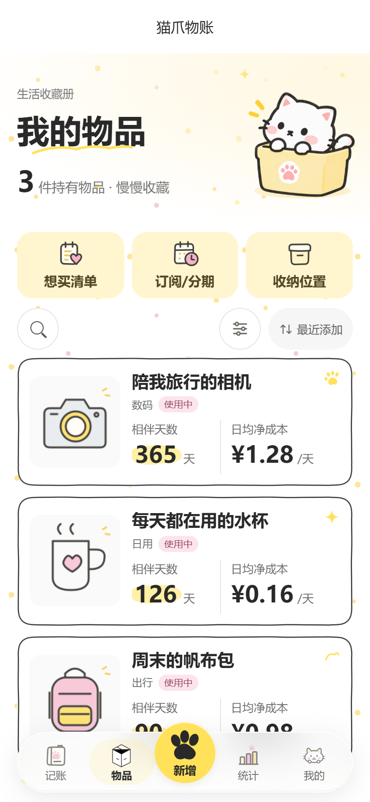
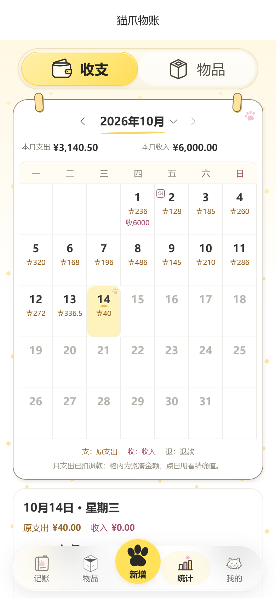

<h1 align="center">PALM／物物记 · 猫爪物账</h1>

<strong>管理喜欢的物品，记录生活的花费。</strong>

一个全程用 <strong>Vibe Coding</strong> 做出来的个人小玩具。欢迎拿来随手试试。

  <a href="#体验猫爪物账">微信小程序体验</a> ·
  <a href="https://github.com/HHH0825/Personal-Asset-Lifecycle-Manager-PALM/releases">Windows 下载</a> ·
  <a href="docs/user-guide.md">网页版使用说明</a> ·
  <a href="wechat/README.md">小程序源码与文档</a> ·
  <a href="https://github.com/HHH0825/Personal-Asset-Lifecycle-Manager-PALM/issues">反馈与建议</a>

  

## 两种记录方式

| | PALM／物物记 | 猫爪物账 |
|---|---|---|
| 适合做什么 | 在电脑上整理物品的完整档案 | 在手机上记物品、日常收支和订阅／分期 |
| 怎么打开 | Windows 安装，或在电脑上从源码启动 | 微信「搜一搜」搜索 **猫爪物账** |
| 数据存在哪 | 电脑本机的数据库和照片目录 | 当前手机的小程序文件目录 |

两个版本各自保存数据，不会自动同步。

## 体验猫爪物账

**打开微信 → 搜一搜 → 输入「猫爪物账」→ 进入小程序。**

**2.0.0 纯前端本地版**，全部工具免费、无需登录。物品、账目和照片都保存在当前手机。小程序代码包下载后，核心功能可以离线使用。

  

  
  
  

物品档案 · 日常记账 · 收支统计。预览使用当前界面源码和虚构数据离线渲染，并非真机截图；点击可查看原图。

- **管理物品**：照片、分类、收纳、维修和处置，也能看持有天数和日均净成本。
- **记清收支**：记账、退款、预算、订阅／分期和月度小报。
- **换机备份**：从「我的 → 资料与完整备份」导出 ZIP，可以发到微信聊天，再从聊天选择文件恢复。换机或清理小程序数据前，记得先导出。旧云端版本的记录不会自动迁入。 [使用与备份说明](wechat/docs/local-first-usage.md)

## PALM／物物记 · 本地网页版

在电脑上为物品建档，记录 **购买 → 使用 → 维修 → 闲置 → 处置**。支持照片、日均成本、费用统计、月度回顾和回收站。

  

### 开始使用网页版

- **Windows 安装版**：从 [Releases](https://github.com/HHH0825/Personal-Asset-Lifecycle-Manager-PALM/releases) 下载；操作步骤见[安装说明](packaging/windows/README.md)。
- **源码运行**：Windows 双击[启动 PALM.bat](<启动 PALM.bat>)，首次运行会自动配置环境；也可安装 `requirements-lock.txt` 中的依赖后运行 `python app.py`。

启动后访问 <http://127.0.0.1:5000>，关闭启动终端即可停止服务。网页版运行环境为 Python 3.10+、Flask 与 SQLite。

## 关于这个小玩具

项目从第一版到现在，全程用 **Vibe Coding** 开发。我和 AI 一边写、一边试，把整理物品和记账时想到的小功能慢慢做了出来。大家可以把它当作一个自己用着顺手、顺便分享出来的小玩具。

欢迎试玩，也欢迎告诉我哪一步不好用、或者你想怎么记。反馈时带上版本、设备和复现步骤，截图里记得遮住个人资料和账目。 [GitHub Issues](https://github.com/HHH0825/Personal-Asset-Lifecycle-Manager-PALM/issues)

## 文档与开发

- **本地网页版**：[使用说明](docs/user-guide.md) · [接口](docs/api.md) · [架构](docs/architecture.md) · [备份与升级](docs/backup-restore.md) · [测试与演示](docs/testing.md)
- **微信小程序**：[介绍与开发入口](wechat/README.md) · [本地使用与备份](wechat/docs/local-first-usage.md) · [构建与发布说明](wechat/docs/local-first-release.md) · [GitHub 上传说明](wechat/docs/github-upload.md) · [历史开发记录](wechat/docs/development-history.md)
- **宣传素材**：[来源与可编辑文件](wechat/docs/promo/README.md)

## 许可证

源码采用 [PolyForm Noncommercial 1.0.0](LICENSE)，允许符合条款的非商业使用；超出许可范围的商业使用须另行取得书面授权，可通过 [GitHub Issues](https://github.com/HHH0825/Personal-Asset-Lifecycle-Manager-PALM/issues) 联系作者。历史 MIT 授权及第三方许可见 [授权说明](docs/licensing.md)。
