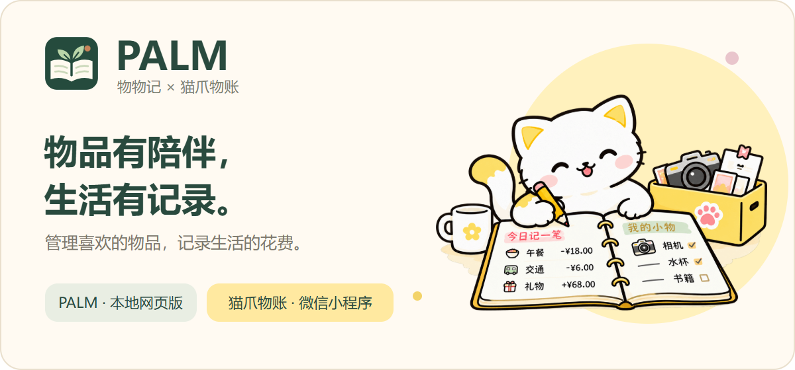
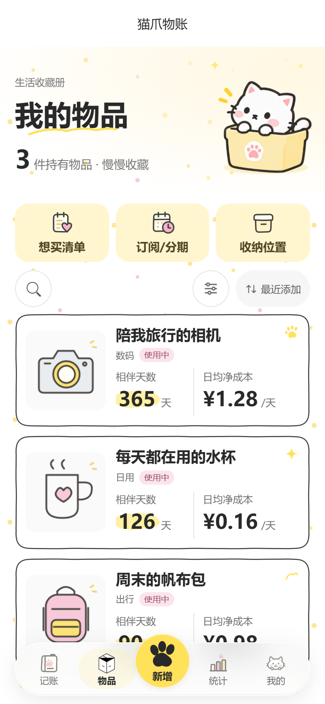
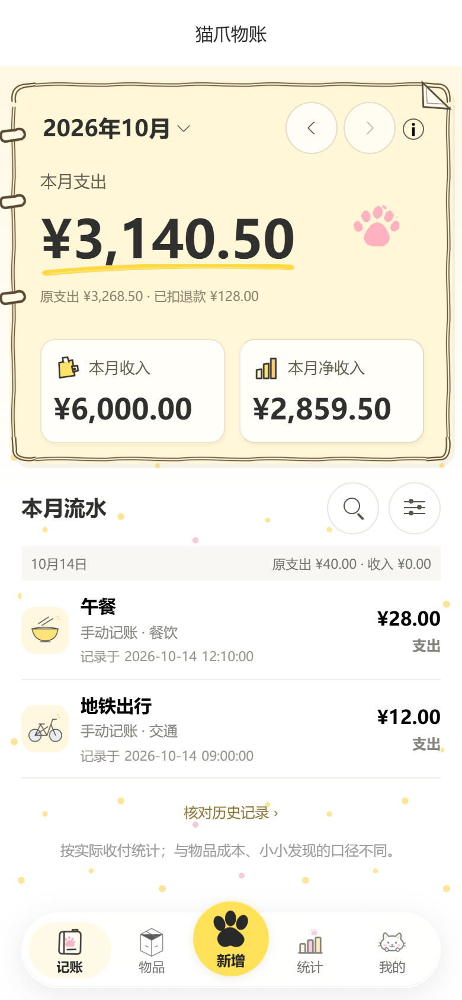
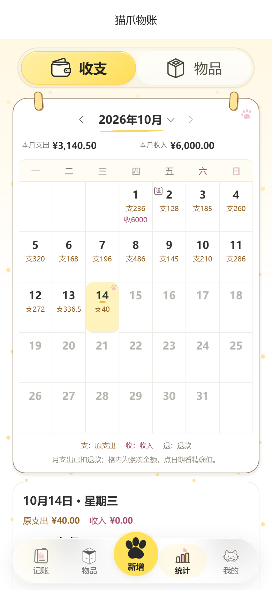

<p align="center">
  
</p>

<h1 align="center">猫爪物账 · 微信小程序</h1>
<p align="center"><strong>收好每件小物，记清每笔收支。</strong></p>
<p align="center">在微信里记录物品的陪伴，也记下生活的收支。</p>
<p align="center">
  <a href="#打开微信开始记录">立即体验</a> ·
  <a href="#功能一览">功能一览</a> ·
  <a href="#开发与测试">开发与测试</a> ·
  <a href="https://github.com/HHH0825/Personal-Asset-Lifecycle-Manager-PALM/issues">反馈与建议</a> ·
  <a href="../README.md">了解 PALM 网页版</a>
</p>

## 打开微信，开始记录

**微信 → 搜一搜 → 搜索「猫爪物账」→ 进入小程序。**

<p align="center">
  
</p>

搜索图是手动搜索指引。线上功能以微信内实际发布版本为准；本目录为可编辑源码，最新开发内容不等于已经上线。

## 功能一览

| 想做什么 | 可以怎样记录 |
|---|---|
| 整理拥有的物品 | 建立档案，添加照片或选择图标，按分类、状态与收纳位置查找 |
| 了解物品的陪伴与成本 | 查看持有天数、日均净成本，记录维修与处置 |
| 随手记下一笔 | 记录日常收入、支出和退款，回看每月流水 |
| 看清花费去向 | 在收支日历、分类统计与月度小报中回顾 |
| 管理长期付款 | 管理订阅／分期计划和对应付款记录 |
| 按自己的方式整理 | 使用账本、预算与个性化工具，具体开放范围以账户权益说明为准 |

物品、记账、统计、我的四个主栏目，配合100种物品图标与小猫插画。部分扩展能力需要相应账户权益，不代表所有功能均免费开放。

<p align="center">
  <a href="docs/promo/items.png"></a>
  <a href="docs/promo/ledger.png"></a>
  <a href="docs/promo/statistics.png"></a>
</p>
<p align="center"><sub>物品档案 · 日常记账 · 收支统计。当前界面源码与虚构数据的离线渲染预览，并非真机截图；点击可查看原图。</sub></p>

## Vibe Coding，和真实使用一起成长

这是一个以 **Vibe Coding** 方式持续打磨的个人项目，在 AI 协作中把想法逐步变成可使用的工具。欢迎体验，也欢迎通过 [GitHub Issues](https://github.com/HHH0825/Personal-Asset-Lifecycle-Manager-PALM/issues) 反馈问题和建议。

反馈时请说明使用的版本、设备／系统、操作步骤，以及预期与实际表现。截图请遮挡个人资料、账目等敏感信息。觉得有用，也欢迎 Star 或分享给有相同需求的朋友。

## 与本地网页版的关系

本目录包含小程序前端与独立后端。它与上一级的 PALM／物物记本地网页版共享项目理念，但**账户、数据库与照片独立，不会自动同步**，也不需要运行本地网页版才能体验线上小程序。

自己的源码副本需配置自己的微信 AppID、云环境和服务端凭证；复制此目录不会自动拥有现有线上服务的管理权限。

## 源码更新与发布状态

截至2026-10-21，最新订阅／分期直观表单、可选首笔付款及记账删除联动已进入提交／体验阶段，**尚未正式发布**。这里说明的是当前源码，不将其作为线上已开放功能承诺。

源码还包含订阅页 WXSS 编译修复和付款历史按钮样式调整。规则与验收记录见[订阅／分期更新说明](docs/subscriptions-20261021.md)，上传版本号不作为发布完成的依据。

- 当前源码有24个页面URL；最近构建记录：源码主包1,440,040字节，正式构建主包1,361,288字节。
- 2026-10-21源码独立目录回归：前端476/476、后端420/420；真机与实际上线行为需按体验版检查。
- 正式请求模式使用 CloudBase HTTP 云函数直连，开发登录默认关闭。

## 开发与测试

| 目录 | 用途 |
|---|---|
| `miniprogram/` | 微信开发者工具导入目录，包含页面、组件与运行图片 |
| `backend/` | Flask业务代码、SQLite／CloudBase存储与事务 |
| `deploy/cloudbase/api/` | palm-api启动入口、固定依赖与配置占位示例 |
| `deploy/cloudbase/bridge/` | 兼容转发入口 |
| `deploy/cloudbase/pay-notify/` | 支付通知入口 |
| `branding/` | 图标、插画源文件及素材清单 |
| `tests/`、`tools/` | 回归测试、构建与本地验收工具 |
| `docs/` | 接口、配置、更新与宣传素材说明 |

用微信开发者工具导入 `wechat/miniprogram/`。开发自己的副本时替换 AppID 和云环境配置；本地联调参考 `deploy/miniprogram.config.example.js` 与 `backend/dev.py`。不要将模拟登录配置用于正式环境。

在整个仓库根目录运行前端回归：

```powershell
node --test wechat/tests/*.test.cjs
```

后端需 Python 3.10+。按 `wechat/requirements-lock.txt` 安装依赖后，在仓库根目录运行：

```powershell
python -m unittest discover -s wechat/tests -p 'test_*.py'
```

AppID和环境ID是客户端配置标识；真实 AppSecret、云密钥、支付密钥只在服务端配置，不提交到 Git。

## 构建、部署与更多文档

开发者工具可直接编译源码。压缩构建入口 `tools/build-beauty-icons.cjs` 使用已安装微信开发者工具自带的 Terser，首次使用参考 `tools/extract-wechat-terser.py`。

`tools/prepare-current-release.py` 是复用本机已有ZIP依赖的离线打包工具；干净克隆没有这些包时，先用 `deploy/cloudbase/build.py` 准备基础Linux依赖。不能将Windows虚拟环境作为Linux云函数依赖上传。Git提交不会自动部署后端或发布小程序。

- [接口说明](docs/api.md) · [部署说明](docs/deployment.md) · [云端照片配置](docs/cloud-photos-cos.md)
- [GitHub上传步骤](docs/github-upload.md) · [订阅／分期源码更新](docs/subscriptions-20261021.md)
- [历史开发与验收记录](docs/development-history.md) · [宣传素材来源与编辑](docs/promo/README.md)

历史原生验收脚本可能依赖开发者工具或本机生成记录，不属于普通回归测试前置条件。此前README长篇记录已经完整归档，旧功能和部署状态请结合日期阅读。

## 许可证

源码采用 [PolyForm Noncommercial 1.0.0](LICENSE)；超出许可范围的商业使用须另行取得书面授权，可通过 [GitHub Issues](https://github.com/HHH0825/Personal-Asset-Lifecycle-Manager-PALM/issues) 联系作者。历史 MIT 授权见 [NOTICE](NOTICE)，第三方材料仍遵循原许可。
