# 小程序历史开发与验收记录

[返回当前介绍](../README.md)

> 本文由此前 README 归档。功能、部署状态和测试数字均反映记录当时情况，不代表当前线上状态；以当前 README 和对应更新说明为准。未提交的历史构建物仅保留路径记录。

以下保留此前开发记录。其中旧界面、旧部署状态与日期目录链接仅供追溯，不代表当前功能或已发布状态；历史ZIP、批量截图及本机验收输出不随Git仓库上传。当前源码与说明以[小程序 README](../README.md)为准。

> 2026-10-19 未使用组件提示修复：订阅进度、保存纸签组件移到使用它们的分包，删除物品列表冗余声明；原生扫描“无使用组件”已通过。最新包、截图和更新步骤见未使用组件修复说明（本机历史产物：`deploy/cloudbase/beauty-icons-20261018/未使用组件修复说明.md`，不随仓库提供）。

> 2026-10-19 登录插画兼容修正：已撤回WebP主图，改回同尺寸、像素完全一致的透明PNG；已核对实际编译资源清单。当前包与说明见登录插画兼容修复说明（本机历史产物：`deploy/cloudbase/beauty-icons-20261018/登录插画兼容修复说明.md`，不随仓库提供）。

> 2026-10-19 导航返回修复：移除自定义组件暂时不可用时显示原生导航的兜底，当前前端包已包含。说明、截图及手机复测步骤见导航重复修复说明（本机历史产物：`deploy/cloudbase/beauty-icons-20261018/导航重复修复说明.md`，不随仓库提供）。

> 2026-10-19 代码质量与分包优化：现为10个普通分包，24个页面URL不变；源码主包1,432,251字节，正式主包1,354,335字节。原生扫描仍有主包大小及媒体合计200K两项未通过，不能视为全通过。最新包、校验值和实际验收见代码质量优化说明（本机历史产物：`deploy/cloudbase/beauty-icons-20261018/代码质量优化说明.md`，不随仓库提供）。

> 2026-10-18 上传包体修复：100图标版已采用8个普通分包，保留全部24个页面URL及全部图片。上传错误80051的处理与最新包见上传超限修复说明（本机历史产物：`deploy/cloudbase/beauty-icons-20261018/上传超限修复说明.md`，不随仓库提供）。当前构建按源码／正式构建分别核对每个包，旧总文件量检查记录不作为当前上传依据。

> 2026-10-18 上线清尾：当前为100图标版。最终包、校验值、清理记录与上线检查见 上线清尾与检查说明（本机历史产物：`deploy/cloudbase/beauty-icons-20261018/上线清尾与检查说明.md`，不随仓库提供）。本地仅保留当前版、上一版90图标备份及必要桥接包；下方带日期的文档是历史开发记录，其中旧ZIP链接可能已清理。当前离线打包入口为 `tools/prepare-current-release.py`，不再使用历史单次发布脚本准备新版本。

> 2026-10-17 会员公告改为每账号本机首次弹窗，年会员停止新购，仅保留月／季套餐；已有权益和历史订单继续处理。该次更新记录和手动停售清单见 [公告与年会员停售说明](member-announcement-manual-20261017.md)。

> 2026-10-16 会员工具精简：账单日历及批量确认已下线，免费订阅／分期和历史数据保留。当次页面与部署说明见 [会员工具更新说明](member-refine-manual-20261016.md)。

# 猫爪物帐 · 微信小程序版

> 2026-10-15 已在本地接入个人主体虚拟支付代码：会员下单、双签名、云函数通知核实、幂等开通、查单补发及退款核对。购买默认关闭，未部署或真实收款。配置步骤与13项验收结果见 [虚拟支付接入说明](virtual-payment-20261015.md)。

> 2026-10-15 本地新增“猫爪会员”订阅展示页及多账本、标签、自定义分析、预算和手账外观。此为初版开发记录，当前功能与在售套餐以顶部最新更新说明为准。详见 [会员开发、迁移与验收说明](membership-20261015.md)。本次未部署正式环境。

> 2026-10-13 本地新增记账首版：手动收支、物品联动、退款、历史核对及统计。详见 [交付与迁移记录](cash-ledger-20261013.md)。后端更新包尚未部署；旧服务端仍显示筹备提示。

> 同日完成 [月度面板与统计日历改版](ledger-journal-20261013.md)：新增当天流水查询与完整筛选结果的每日合计。新版部署包仅在本地，已有记账后端无需新增集合、索引或迁移。

**猫爪物帐**是 PALM 项目的独立微信小程序版，介绍语为“每件物品，都有自己的故事”。`wechat/` 可单独复制使用，数据库、照片、微信登录资料均由本目录的后端保存；原单机网页版的 `instance/` 和账号不会自动同步，也不需要运行原网页版。

## 目录

```text
wechat/
├─ backend/          独立 Flask 服务与业务规则副本
├─ miniprogram/      猫爪物帐原生小程序（WXML、WXSS、JavaScript）
├─ tests/            Python 与 Node 测试
├─ deploy/           Linux 服务器部署模板
├─ docs/             接口、部署及演示说明
├─ requirements-lock.txt
└─ .gitignore
```

业务副本依据原项目提交 `7763b2d6cb4d869b0695e380fb38d63c0ebfd0d8`，独立版本后续修复需分别维护。数据结构与原项目相似，但版本号为 15，**不要将两个版本指向同一数据库**。

## 本机开发

当前 CloudBase 正式请求采用 HTTP 云函数直连，部署包、配置及验收记录见 [直连部署与验收](cloud-http-direct.md)；[迁移记录](cloudbase-migration.md)保留原转发方案供回退。本地与云端使用明确的存储模式，历史数据不自动导入云端。

需要 Python 3.10+、微信开发者工具；运行前端测试还需要 Node.js。以下命令在 `wechat/` 目录执行：

```powershell
py -3 -m venv .venv
.\.venv\Scripts\python.exe -m pip install -r requirements-lock.txt
.\.venv\Scripts\python.exe backend\dev.py
```

专用本地入口 `backend/dev.py` 会开启模拟登录，并显示“本地模拟登录已开启”和地址 `http://127.0.0.1:5001`；只允许本机访问，不需要每次设置环境变量。本机数据仍写入 `wechat/instance/`，沿用原有调试账号和物品。关闭该终端或按 `Ctrl+C` 停止服务。

用微信开发者工具导入 `wechat/miniprogram/`。检查 `project.config.json` 中的 AppID：使用自己的小程序 AppID，或选择测试号进行本地页面和接口联调。在工具中暂时关闭域名校验，保持 `miniprogram/config.js` 的 `DEV_LOGIN: true` 和 API 地址 `http://127.0.0.1:5001`。按钮显示“登录体验”，下方注明“开发者工具模拟登录”，会以 `dev:student` 建立本地测试账户。要检查多账户隔离，可暂时修改 `DEV_ACCOUNT` 为另一个名称，退出后重新登录。**这种模拟登录只能用于本机开发，不能作为体验版认证。**

原有入口也可继续使用，在同一个 PowerShell 窗口中执行：

```powershell
$env:PALM_WECHAT_DEV_LOGIN = '1'
.\.venv\Scripts\python.exe backend\app.py
```

若显示“本地调试登录未开启，请使用本地开发启动入口”，先用 `Ctrl+C` 停止旧服务，再运行 `backend/dev.py`，然后重新编译小程序。环境变量仅对当前 PowerShell 及其启动的程序生效，设置后需要重启后端。若正式模式显示“服务器尚未配置微信登录”，应按部署说明在服务器配置微信凭证；本地调试不需要 AppSecret。启动提示端口占用时先停止原有的 5001 服务，不要同时运行两个入口。

若显示“连接失败，请检查网络和后端地址”，先在浏览器访问 `http://127.0.0.1:5001/healthz`。返回 `{"ok":true}` 表示服务可达；再查看开发者工具控制台或 Network 中失败请求的实际地址，应为 `http://127.0.0.1:5001/api/mp/auth/login`。若配置文件已是 5001，但请求仍指向旧端口（例如临时检查使用的 5002），重新保存 `config.js`，通过“工具 → 编译”（`Ctrl+R`）完整编译；仅刷新模拟器可能继续使用旧编译产物。恢复测试配置后也要核对实际请求，不能只检查文件内容。此操作不需要删除物品数据或重新安装依赖。

若“新增”、个人资料点击无反应，或“发现”连固定标题都没有显示，先通过“工具 → 编译”（`Ctrl+R`）完整编译，再用“项目 → 重新打开此项目”重新建立调试会话。本次在正常项目实际复现了这些异常；关闭自动热重载、重新加载后，同一份页面源码恢复跳转及发现内容。项目默认关闭 `compileHotReLoad`；已有项目的 `project.private.config.json` 可能覆盖公共配置，需要同时核对本地“自动热重载”选项。不要通过删除数据库、会话或照片解决页面渲染问题；这个对照结果也不代表所有空白页都由热重载导致。

个人资料、新增和物品详情入口会阻止重复点击；跳转失败显示“页面暂时无法打开，请重试”，具体跳转原因写入开发者工具控制台。返回来源页面后可再次打开。纸签、头像及背景仅作装饰，不接收按钮点击。

“发现”分别读取统计和分析，一部分失败时仍显示另一部分成功内容，并提供“重新读取统计”或“重新整理分析”。加载失败不会显示为零物品或空分析；返回格式异常也会给出提示。离开页面、快速重复读取或切换账号后，旧响应不再更新当前页面。

## 功能范围

- “物品”：搜索、状态筛选、新增和编辑物品、保修日期、照片、置顶、日均费用与持有天数。
- 详情：维修、处置记录的新增、修改、删除；旧使用记录归入默认收起的“历史使用记录”，仅供查看；物品删除进入回收站。
- “发现”：累计费用、物品数量及基于规则的保修、手动闲置与费用分析，另有月度收藏画页入口。
- “我的”：点击顶部头像与昵称栏进入“个人资料”，修改显示名称及六种预设头像；小芽、猫咪、书本、太阳、单车、星星使用原创收藏册插画，切换时即时预览，保存后显示在“我的”，再次打开仍保留。图片失败时回退文字标记；主页保留回收站、陪伴纪念册、反馈与建议、支持作者及退出登录。
- “个人资料”：读取成功后可编辑，保存成功返回“我的”；未保存就返回不提交修改。昵称与头像同步当前会话，重新打开仍可读取；读取失败可重试，提交失败保留填写内容。

## 界面与配色

界面采用**旧纸收藏册**：燕麦纸 `#F2EADF` 背景、暖白纸 `#FFFCF7` 卡片、浅纸色 `#F5EFE5` 指标栏和柔杏 `#E3BFA6` 主按钮。页头用鼠尾草绿 `#DDE4D7` 格纹、陶粉 `#E8D1C8` 纸片与奶咖 `#E7D6BD` 胶带形成拼贴，背景叠加轻纸纤维纹理。卡片、输入框和费用区域保持纯色；正文和数字为深可可 `#493B35`，辅助文字加深为 `#635147`，强调与选中导航使用棕红 `#845645`。颜色和尺寸集中在 `miniprogram/app.wxss`，不增加运行依赖。

清单的“新增”改为猫爪、加号和折角纸签；“收藏的小日常”使用窄纸条与小印章。录入表单的 **01 基本信息、02 购买与保修、03 照片与备注**分别使用档案书签、购买票据、照片角贴与铅笔。原文和编号通过原生组件显示，图案加载失败也能读到文字；新增仍是原生按钮，整块 46px 高度可点击。七种纸签、九种类型插画、猫爪收藏册 Logo 与三种背景均保留可编辑 SVG，页面使用同步导出的透明 PNG；素材和重新导出步骤见 [纸签素材说明](paper-assets.md)。

三项指标继续使用细线分隔的统一账本栏；详情保持两列布局。发现使用白纸分析卡与类别小标记；“我的”保持可点击的头像昵称栏，资料编辑位于独立页面。登录使用收藏册入场券，保存使用归档票据，暖白纸面配细棕线与少量胶带；次要操作及恢复使用纸色和细边框，永久删除使用陶红文字。状态保留文字，不仅通过颜色表达。普通文字与底色对比度不低于 4.5∶1，包含页头纸片、纸纹、按钮和禁用状态。

- 拼贴随内容自然滚动，不占布局、不接收点击；每页集中于页头与边缘，不在每张物品卡重复堆叠。已移除柔光渐变、星星和鲜亮矩形标题，不增加连续动画。
- 登录前保留收藏盒小猫和示例档案，配合鼠尾草与陶粉纸片、收藏章和纸券登录入口，明确标注“示例档案 · 非账户数据”；示例不参与统计。短屏可以正常向下滚动，登录按钮不固定在屏幕底部。
- 六张原创透明 PNG 贴纸覆盖首页、清单、发现、我的、表单、生命周期和回收站，搜索无结果时显示找物品的小猫。贴纸合计约 157 KiB，纸签、导航、头像、类型插画与背景 PNG 合计约 377 KiB，全部随小程序打包；装饰有独立预留空间，不遮挡字段和按钮。素材和完整生成提示见 [贴纸说明](stickers.md)。
- 登录页通过 `miniprogram/utils/layout.js` 读取可用窗口尺寸，插画高度限制在 140–220px，随窗口高度调整，并响应窗口尺寸变化。全站内容最大宽度 480px、居中显示；字号与控件采用稳定的逻辑像素尺寸，底部保留安全区域，避免大屏按比例放大或短屏挤压内容。不按机型名称写死布局。
- 物品清单突出持有天数、购买价/天和净成本/天；有照片时显示缩略图，无照片或读取失败时显示对应类型线条插画。
- 缩略图按可见区域读取，最多同时读取三张，同一照片并发读取会复用请求。临时图片在当前会话内共用，返回清单可复用；退出或切换账号清除，不写入持久存储。
- 详情用时间线展示生命周期；发现展示统计摘要与规则卡片；录入表单按基本信息、购买与保修、照片与备注分组。
- 底部“物品、发现、我的”使用原生图文导航，分别为猫爪收藏盒、放大镜档案页、猫耳头像档案卡；普通与选中版本保持相同形状，选中增加棕红轮廓和少量拼贴色。SVG 源文件与 81×81px 透明 PNG 随包提供，不使用自定义导航或图标库。

检查界面时可在开发者工具切换窄屏设备、输入长名称，核对表单焦点、错误提示和键盘弹出后的布局。登录、计算、接口和数据库字段均沿用原有规则。

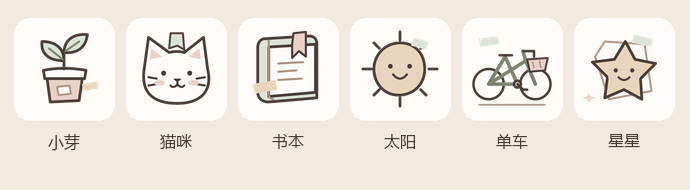

登录纸券本地模式显示“登录体验”，正式模式显示“微信登录”；新增与编辑的归档票据保留“保存物品”。两种入口都是原生按钮，高度 56px、居中且宽度不超过 360px 和页面可用宽度；加载时显示“登录中…”或“保存中…”并禁用重复点击。图案没有嵌入文字，图片失败仍能读取和点击原生文字。首页左上角使用 32×32px 的猫爪收藏册 Logo，旁边保留“猫爪物帐”，图片失败回退“猫”字。微信后台头像未更换，底部导航文字保留，新增对应的纸签图标。

### 局部暖玻璃

“档案／照片墙”玻璃切换缩小为 128px 宽，外层内边距为 1px；两个按钮仍保留至少 44px 点击高度和 12px 文字。

搜索框、档案／照片墙切换、“我的”顶部资料栏、月报月份选择及预览／保存按钮增加暖玻璃质感：88% 暖白底面、细高光、淡棕边线与轻阴影。视图选中项保留鼠尾草绿；照片、费用和月报正文继续使用纸面，登录、新增与保存物品继续使用纸签。

公共颜色与质感集中在 `miniprogram/app.wxss` 的 `--glass-*` 变量和 `.warm-glass`；各页面只给指定控件使用。`backdrop-filter: blur(8px)` 是增强效果，未支持时仍显示半透明底面；按压只变暗约 120ms，减少动态效果时取消过渡。不新增素材或运行依赖。

| 搜索与视图切换（Mate 80 模拟尺寸） | 透明资料栏（320px） | 月报操作区（320px） |
| --- | --- | --- |
| 暖玻璃搜索与切换（本机历史产物：`docs/images/glass-items-mate80.png`，不随仓库提供） | !暖玻璃资料栏（本机历史产物：`docs/images/glass-me-320.png`，不随仓库提供） | !暖玻璃预览与保存按钮（本机历史产物：`docs/images/glass-actions-320.png`，不随仓库提供） |

已检查五种代表尺寸和关闭模糊后的回退画面；具体操作范围见 [暖玻璃验收记录](visual-check.md#2026-10-04至05局部暖玻璃)。Android／iPhone 的实际模糊、滚动、系统键盘与保存相册尚待真机验收。开发者工具完整编译后可查看更新。

### 本轮界面：精简切换与反馈入口

| 128px 视图切换（Mate 80 模拟尺寸） | 我的新入口（390px） | 支持作者（430px） |
| --- | --- | --- |
| 精简的档案与照片墙切换（本机历史产物：`docs/images/controls-items-mate80.png`，不随仓库提供） | !反馈与支持作者入口（本机历史产物：`docs/images/feedback-me-390.png`，不随仓库提供） | !支持作者感谢页（本机历史产物：`docs/images/support-430.png`，不随仓库提供） |

本轮只增加感谢介绍页，尚未接入收款。反馈由微信原生页面提交，查看方法见 [反馈说明](feedback.md)。尺寸、图标排查及实际照片保存结果见 [本轮验收记录](visual-check.md#2026-10-05精简控件反馈与照片瘦身)。

### 物品照片与压缩

最终编辑照片在提交前预处理，失败会保留填写内容和草稿。后端将清晰照片限制为 **1600px／512 KiB**，缩略图限制为 **480px／80 KiB**；保持比例、校正拍照方向、移除元数据，不放大小图。旧清晰照片不批量改写，替换与删除继续清理两份照片。具体规则和压缩对照见 [照片说明](photos.md#实际存储上限)。

点击“选择照片”或“重新选择”，明确选择“从相册选择”或“拍一张照片”；相机默认后置，每次一张。预览后可选择“裁剪”（1∶1，可调整取景范围）或“旋转”（每次顺时针 90°），也可直接保存。编辑已有物品时自动读取原照片；读取失败可重试，继续保存其他信息不会删除原照片。

照片只在点击“保存物品”后上传，不修改相册原图。新增物品的最终编辑照片会另存到本机草稿目录，重启后可继续填写；编辑已有物品仍使用临时图片。选图、裁剪和旋转期间禁用重复操作及保存；取消或失败保留之前的照片，权限被拒绝会提示用户自行检查设置。裁剪需微信基础库 2.26.0，旧版本仍可选图、拍照与保存；旋转输出最长边不超过 1600px 的 JPEG。上传沿用 5 MB 限制与部分成功提示。开发者工具不能代替真机验证相机与原生裁剪，详见 [照片功能说明](photos.md)。

### 页面展示

以下为历史页面检查截图；首页使用内置示例，录入表单尚未提交。截图可能仍包含已经退役的使用记录入口或旧版小报，当前功能以本文说明和实际页面为准。

| 登录前首页（Mate 80） | 录入上半部（Mate 80） | 录入下半部（Mate 80） |
| --- | --- | --- |
| 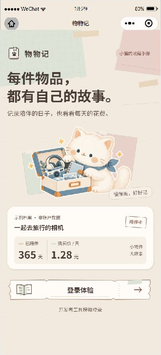 | 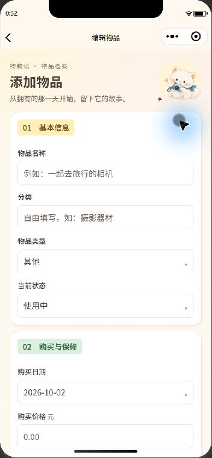 | 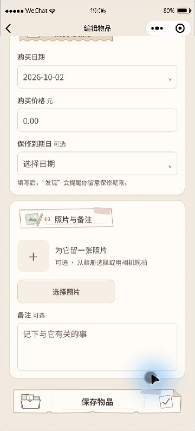 |

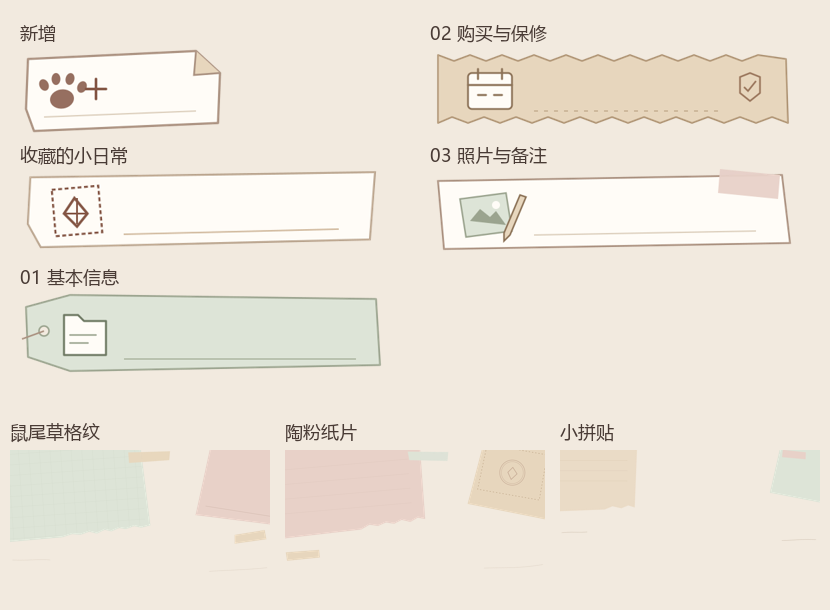

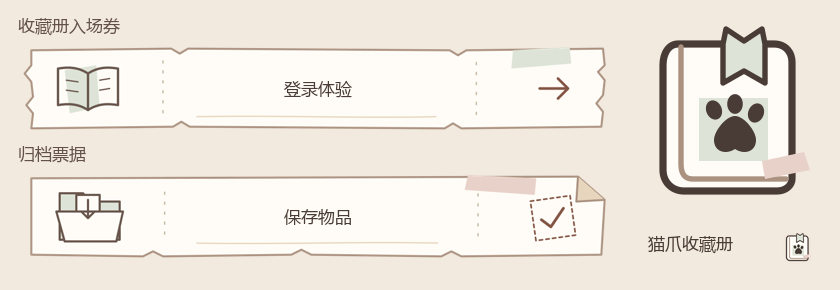

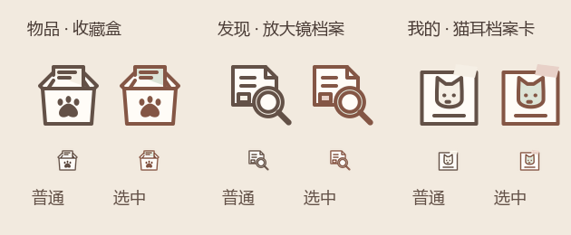

| 原生导航（Mate 80，空清单） | 照片来源菜单（Mate 80，未选择） |
| --- | --- |
| 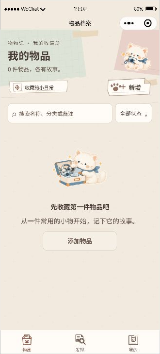 | 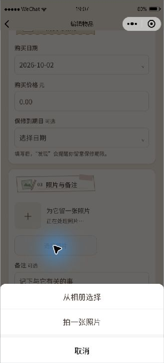 |

更多页面截图、实际检查结果及真机待验证项目见 [界面验收记录](visual-check.md)。

### 入口右对齐

物品页“新增”位于工具栏右端，与搜索框及卡片右侧对齐，保留 104×46px 点击区域。发现页“本月记录”标题居左，“收藏小报”居右，点击高度至少 44px。手机仍保留原边距，平板入口跟随居中的收藏册内容区，两处均随内容滚动。

| 物品页新增（Mate 80 模拟尺寸） | 发现页收藏小报（Mate 80 模拟尺寸） |
| --- | --- |
| 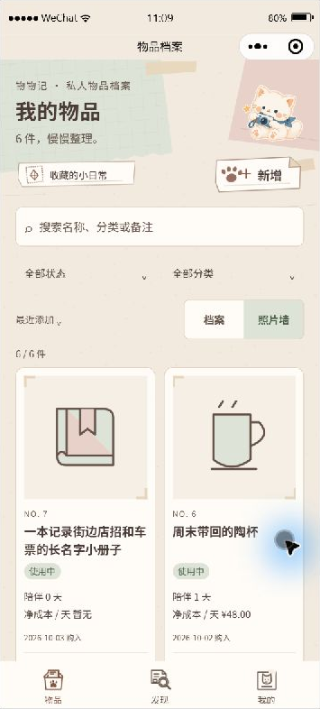 | 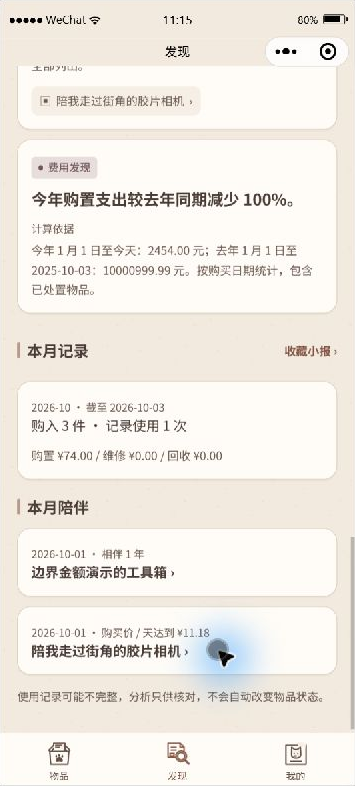 |

本轮在独立项目检查 320×568、366×809、390×844、430×932 和 768×1024 的入口位置；实际页面与操作覆盖范围见 [本轮验收记录](visual-check.md#入口右对齐与屏幕适配检查2026-10-03)。模拟器结果不代替真机和系统键盘验收。

| 发现页（独立虚构数据） | 后端停止时的分别重试 |
| --- | --- |
| 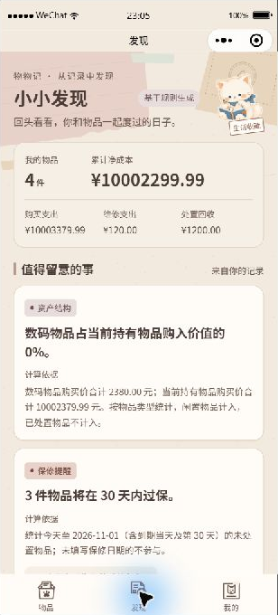 | 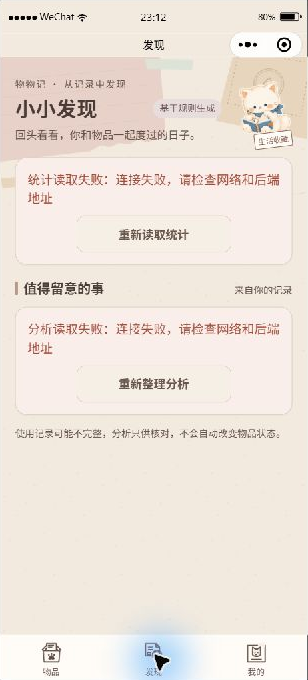 |

独立测试项目的物品清单使用虚构数据，已检查 320px、390px、430px、Mate 80 和平板的列表与导航排版；这些截图不代表相机、裁剪或真机验收已完成。

| 窄屏（320px） | Mate 80（366px） | 平板（768px） |
| --- | --- | --- |
| 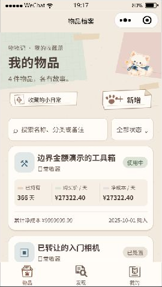 | 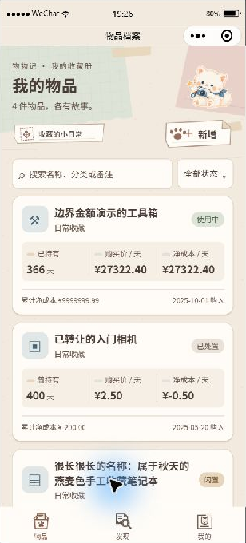 | 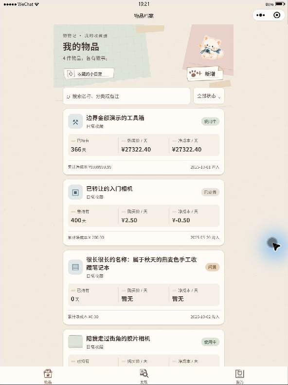 |

回收站保留 30 天；后端启动及访问回收站时清理到期物品。日均净成本为 `(购买价 + 维修费 - 回收金额) ÷ 持有天数`；购买当天显示“暂无”。规则分析基于录入数据，不自动推断物品闲置。现已支持月度收藏小报和 PNG 图片保存；CSV、订阅提醒和单机版数据同步留待后续。

## 真机体验版

真机需要自己的小程序 AppID、可从手机访问的 HTTPS 后端和已配置的合法 request/upload/download 域名。先按 [部署说明](deployment.md) 配置服务器与微信后台，再将 `miniprogram/project.config.json` 的 AppID 和 `miniprogram/config.js` 的 API 地址替换成自己的值，并设 `DEV_LOGIN: false`。**AppSecret 只放服务器环境变量，不写进小程序文件。**然后在微信开发者工具里上传代码、设置体验成员并用 Android 和 iPhone 验证。

真机联调和上传体验版还需确认 AppID 所属账号、服务器、合法域名及体验成员配置，本机模拟器检查不能替代这些步骤。具体检查步骤见 [演示说明](demo.md)。

## 新增草稿与详情阅读

新增物品时，字段修改后约 500 毫秒自动保存，离开页面或切到后台时补存。每个账号在当前设备保留一份新增草稿，包含填写内容和最终编辑照片；未修改的空表单、编辑已有物品不生成草稿。再次点“新增”可继续上次填写，也可确认后重新填写；暂不填写会返回清单并保留草稿。

草稿按后端地址和用户编号隔离。同一账号退出、重新登录仍可恢复，其他账号看不到；不上传云端、不跨设备同步。清除微信本地数据或卸载小程序可能清除草稿。本机保存失败时显示“草稿未保存”，不影响正式提交；照片丢失时先恢复其他字段，并提示重新选图。

物品创建成功立即将草稿标为完成，照片上传结束后再清理本机草稿照片。照片上传失败仍保留已创建的物品，请进入详情重新编辑，不会因为恢复草稿重复创建。完整说明见 [录入草稿](drafts.md)。

详情页先展示物品封面、名称、陪伴与花费，再显示“编辑物品”和“更多操作”；没有照片时使用紧凑类型插画。置顶、移除照片、移入回收站收进“更多操作”。基本资料默认收起，“维修与处置”默认显示最近三条；纪念默认最近一枚，未设置目标时只显示一行入口。各区可以独立展开，维修和处置记录仍可编辑。历史使用记录位于详情底部，默认收起，仅供查看。

从详情进入编辑或记录页后返回，会保留展开状态并恢复可用滚动位置；重新打开该物品时恢复默认状态，账号切换后清除旧状态。已处置物品保持原操作限制。布局与操作检查记录见 [界面验收记录](visual-check.md)。

| 本机草稿恢复（历史截图，320px） | 收简后的费用与操作（历史截图） | 无照片详情（历史截图，平板） |
| --- | --- | --- |
| 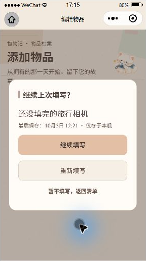 | 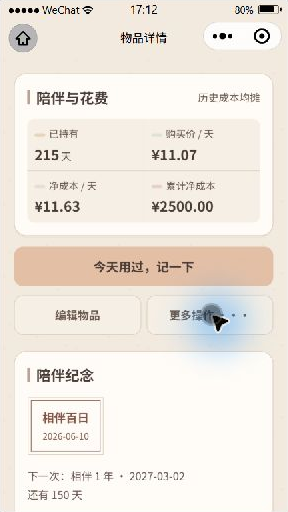 | 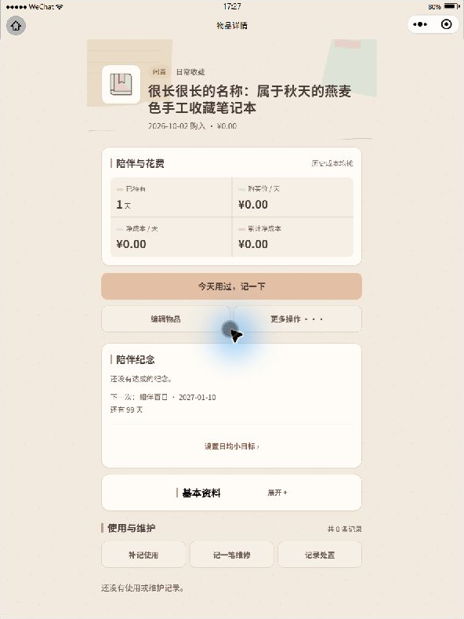 |

以上为上一轮独立账号的开发者工具实际画面。恢复提示当时已在五种代表尺寸检查，部分模拟器按钮操作尚未完成；当前操作结果以最新 [界面验收记录](visual-check.md) 为准，截图本身不代表点击通过。拍照、后台恢复与权限仍需 Android／iPhone 真机检查。

## 新版收藏小报开发者工具截图

以下画面来自独立测试工程，使用虚构数据；不是 Android／iPhone 真机验收。完整记录见 [界面验收](visual-check.md)。

| 月份画页（Mate 80 模拟尺寸） | 窄屏费用刻度（320px） | 实际 PNG 预览 |
| --- | --- | --- |
| 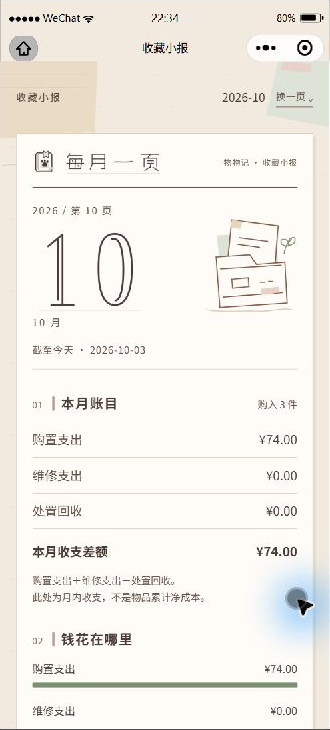 | 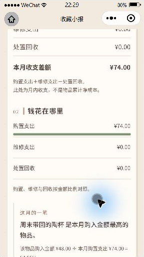 | 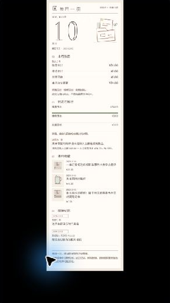 |

| 发现页的小报预览 | 只读的历史使用记录 |
| --- | --- |
| 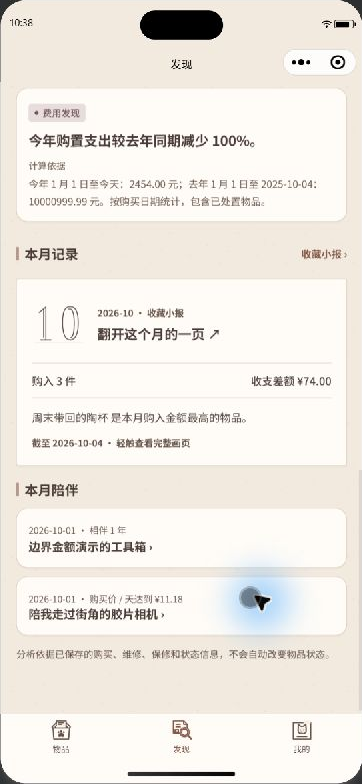 | 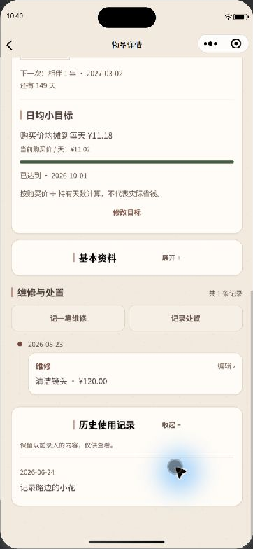 |

## 收藏册、纪念与月度小报

物品主页可在“档案”和“照片墙”之间切换：档案为单列，展示约 80px 照片和完整费用；照片墙为规则双列，展示正方形照片、两行名称、状态、持有天数和净成本/天。照片缺失或读取失败时显示对应类型线条插画。照片角贴、档案编号和日期戳统一使用旧纸收藏册样式，正文整齐对齐。

搜索、状态、分类共同筛选；排序有最近添加、持有最久、购买价格从高到低、净成本/天从高到低。置顶优先、相同值按编号降序，日均“暂无”排最后。清除筛选保留排序与视图；这两项偏好按账号保存，不持久化物品清单。详情返回会恢复条件与可用滚动位置，切换账号清除页面内容和返回位置。

照片仍按可见区域读取。新增、编辑和照片处理流程沿用现有操作。使用打卡与补记入口已退役，清单不显示使用次数、最近使用日期或使用状态提示；不会因用户未录入使用记录而推断物品闲置。

旧使用数据保留在原数据表，可在详情“历史使用记录”中阅读。对应新增、修改、删除和快捷记录接口，在原账号与物品权限校验后返回 `410`，提示“使用记录已停用，历史记录仍可查看”；没有权限或物品已在回收站仍返回 `404`。旧使用日期不再限制购买日期与处置日期的修改，维修与处置的日期校验继续生效。分析兼容字段中仅保留手动闲置内容，未知使用数组为空；旧读取字段暂时保留，详见 [接口说明](api.md)。

详情页“陪伴纪念”展示相伴百日、周年、下一次纪念日期及剩余天数，默认最近一枚，可展开全部。“我的 → 陪伴纪念册”按达成日期倒序汇总。纪念按购买日计算，非闰年 2 月 29 日周年按 2 月 28 日计算，已处置物品截至处置日；回收站物品不参与，恢复后重新出现。

详情还可设置、修改或取消“日均小目标”，金额必须大于零。目标使用 **购买价 ÷ 持有天数**，不会将维修或回收计入，也不代表实际省下的钱。购买当天日均显示“暂无”；已处置物品的目标只读。

发现页“本月记录”以月份字样、收支差额和一条事实摘要预览收藏小报，整张预览可点击；“本月陪伴”继续列出当月纪念。统计、规则分析与月度数据独立加载及重试。小报支持当前月与历史月；日期以服务器口径为准，当前月截至今天，历史月截至月末。购入件数和支出按购买日期、维修按维修日期、回收按处置日期归月。已处置物品保留有效历史事件，回收站物品排除；旧使用记录不计入月度活动。

小报改为收藏册插画画页：大月份字样、原创刊头、档案线描、对齐的账目、同尺度费用横条与日期戳，暖白纸面配燕麦包边，鼠尾草和陶粉只用于线条及边角。月份与刊头使用本地 SVG 导出的 PNG，名称与金额采用原生文字；无需网络字体。网页完整展示当月购入与纪念，空月份显示留白收藏页。

“本月收支差额”＝购置支出＋维修支出－处置回收，金额可为负；负值表示回收超过本月支出，此值不同于物品累计净成本。“这月的一笔”指出本月购买价最高的物品，全部并列时一并列出；占比按每件购买价除以本月购置支出计算，总支出为零时不展示百分比。费用横条共用同一尺度，零金额不绘制色条；结论旁附计算依据。后端使用整数分汇总，金额响应仍为两位小数字符串。

小报按当前保存的记录重新计算，更正记录、修改目标、删除恢复物品后，历史结果会变化。提供“预览画页”和保存到相册：PNG 包含 Logo、月份、购入件数、三项费用、收支差额，以及最多三件购入物品和三条纪念；超出部分注明数量，不包含昵称或照片。图片先测量文字再排版，高度随内容变化，长名称按预留行数换行与省略。相册权限失败时保留页面并可重试，切换月份、读取失败或账号变化会清除旧图片。没有新增数据库字段。

本地源码更新后需要重启后端，让新月度接口生效，再在开发者工具完整编译。正常地址仍为 `http://127.0.0.1:5001`。

### 早期收藏册功能截图（历史记录，独立虚构数据）

| 单列档案 | 双列照片墙 | 日均小目标 |
| --- | --- | --- |
| 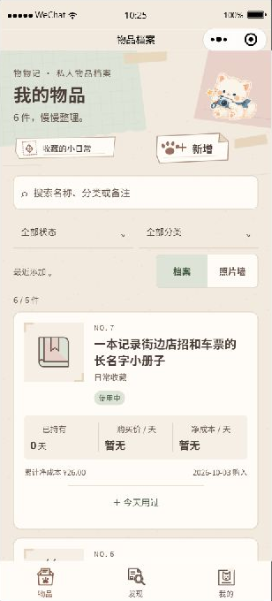 | 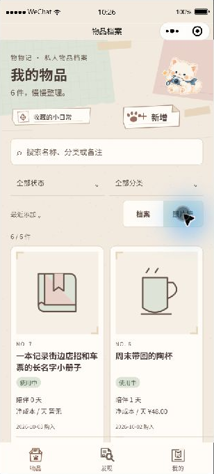 | 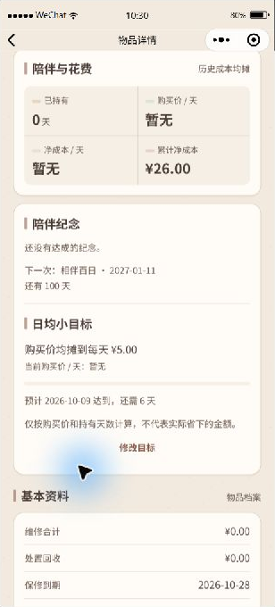 |

| 陪伴纪念册 | 收藏小报 | 原生 PNG 预览 |
| --- | --- | --- |
| 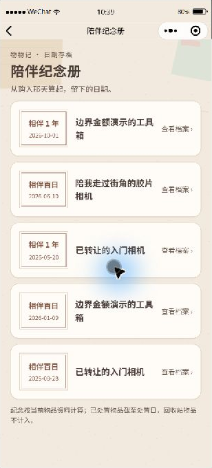 | 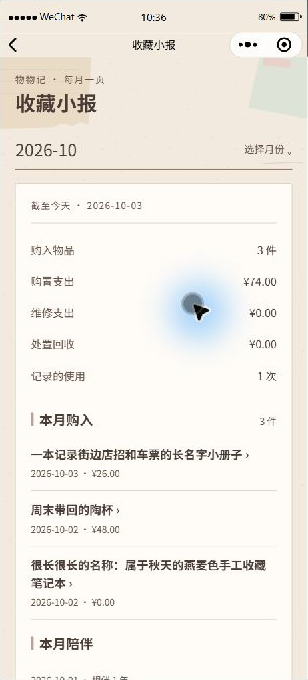 | 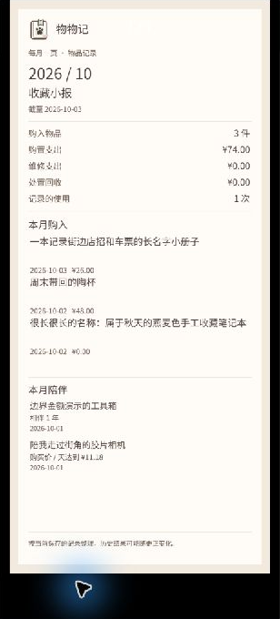 |

以上为此前开发者工具截图，虚构账号的数据与正常项目独立。清单可能仍包含退役的使用入口；小报和 PNG 为旧版排版，不代表本轮画页效果。相册保存和真机表现另行验证。

## 测试

照片加载采用 480px 缩略图与当前会话共用缓存，详情和编辑读取清晰照片。返回清单复用有效文件，失败时可单张重试；缓存最多 60 张或 20 MB，退出和账号切换时清理。旧照片首次读取时生成缩略图，无须数据库迁移；升级后请重启后端并完整编译。详见 [照片说明](photos.md) 与 [Android／iPhone 验收清单](device-check.md)。正常本地配置仍为 5001，真机需要独立 HTTPS 测试配置。

在 `wechat/` 目录、安装 Python 依赖后：

```powershell
.\.venv\Scripts\python.exe -m unittest discover -s tests -p 'test_*.py' -q
node --test tests\frontend.test.cjs
node --test tests\navigation-discovery.test.cjs
node --test tests\collection.test.cjs
node --test tests\draft-detail.test.cjs
node --test tests\monthly-report.test.cjs
node --test tests\photo-cache.test.cjs
node --test tests\photo-submit.test.cjs
python tools/photo-storage-check.py
node tools/photo-benchmark.cjs .venv/Scripts/python.exe
```

`draft-detail.test.cjs` 验证草稿账号隔离、500ms 保存、离开补存、持久照片与文件替换、恢复和丢弃、存储失败、创建后的照片部分成功，以及详情折叠、滚动恢复、旧回调保护和清单跳转降级。

`collection.test.cjs` 验证组合筛选、排序、账号偏好、类型素材、返回位置、目标、月度读取与图片排版；后端 `test_monthly.py` 和 `test_journey.py` 验证归月及日期边界。上面的 Python discover 命令也会运行 `test_usage_retirement.py`，覆盖停用接口的权限顺序、历史只读、旧日期约束解除、仅有旧使用记录的空月份、并列最高、零金额占比与用户隔离。

`monthly-report.test.cjs` 检查新版月报金额与占比读取、费用图比例、动态图片布局，以及本地月份与刊头素材；月份切换和旧图片失效由收藏册相关测试覆盖。

`navigation-discovery.test.cjs` 针对入口跳转、重复点击与失败重试，以及发现页部分失败、响应结构校验、乱序请求和账号切换保护；可单独运行进行本轮定向检查。

后端测试只使用临时数据库和照片目录，还会将后端复制到独立临时目录验证脱离上级项目运行。登录测试直接覆盖本地认证分支，检查调试开关、非本机拒绝、重启复用账号与缺少正式凭证的错误。前端测试覆盖筛选、金额展示、旧账号响应丢弃、缩略图并发限制、失败回退、按可见区域读取和页面离开后的清理，以及短屏/宽屏布局、窗口尺寸读取失败时的默认布局、窗口变化时的适配、主题文字对比度、SVG/PNG 素材引用与三倍导出尺寸、Logo 图片失败回退、纸签图片失败的文字回退、登录和物品保存的重复点击拦截与错误后重试、照片上传失败的部分成功提示、登录凭证模式和登录失败后的会话保留，以及资料保存去重、读取失败重试、未保存返回、会话持久化、账号切换及页面离开后的旧响应保护。新增照片测试覆盖明确相册／相机来源、取消、权限拒绝、编辑失败、裁剪兼容提示、旋转尺寸与 EXIF 朝向、仅上传最终图片、原照片预览不重复上传，以及离开页面或切换账号后的旧回调丢弃。接口字段见 [接口说明](api.md)。

### 反馈、作者页与导航图标

“我的”新增微信原生“反馈与建议”，另有一页作者感谢说明；目前不接入收款。作者登录微信公众平台，在对应小程序的“客服反馈”中查看。点击按钮不是提交成功，手机提交与后台接收仍需实测，操作见 [反馈说明](feedback.md)。

六张底部 PNG 在 `project.config.json` 中明确加入打包列表，资源测试核对路径、81×81 尺寸、透明通道和图案一致性。曾在正常项目复现底部破图，但同一图片通过 `wx.getImageInfo` 可读；完整编译、重新打开项目后恢复。已有私有配置可能覆盖 `compileHotReLoad`，本机私有配置也关闭了热重载。出现类似情况先完整编译并重新打开项目，不要清空账号或数据库。本次未证明某个图标文件损坏；手机预览包仍需核对。

### 照片加载检查

清单使用轻量缩略图，进入详情读取清晰照片；会话内返回清单复用已有文件。以下为独立测试项目的照片墙，测试图片使用本地插画：

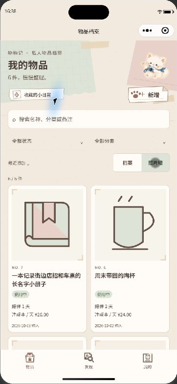

[多尺寸检查与测试对比](visual-check.md#2026-10-04照片缩略图与当前会话缓存)。Android／iPhone 的真实照片和权限操作仍按真机清单验收。


## 许可证

源码采用 [PolyForm Noncommercial 1.0.0](../LICENSE)；超出许可范围的商业使用须另行取得书面授权，可通过 [GitHub Issues](https://github.com/HHH0825/Personal-Asset-Lifecycle-Manager-PALM/issues) 联系作者。历史 MIT 授权见 [NOTICE](../NOTICE)，第三方材料仍遵循原许可。
# 私有云端照片补齐

受限 COS 子账号创建、三个新增环境变量、上传/下载域名、费用核对、验证脚本和启用步骤见 [照片部署说明](cloud-photos-cos.md)。当前照片默认关闭，已有云端业务继续可用。
