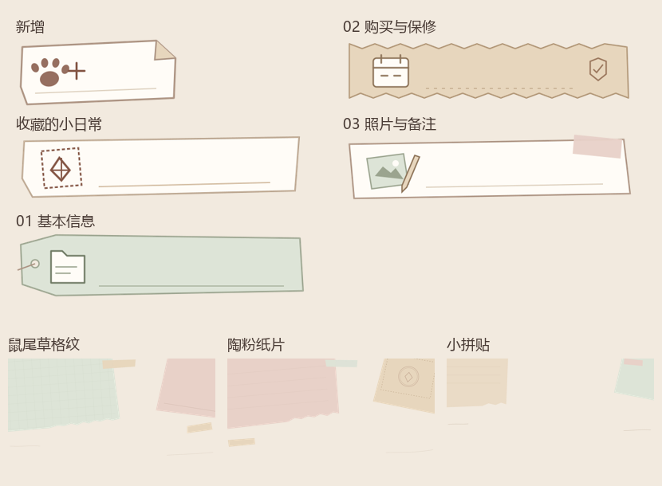
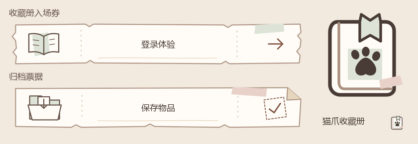
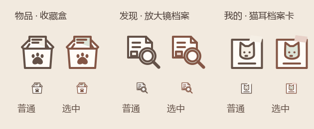
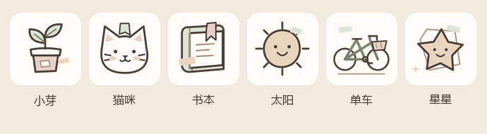

# 旧纸收藏册：纸签与背景素材

2026-10-08 详情改版新增 `miniprogram/assets/detail/` 下的猫爪、邮戳、维修和档案图标；均保留 SVG 源文件与三倍透明 PNG，运行时使用本地 PNG。空状态复用现有猫爪账本标志，未覆盖历史素材。用途及实际截图见 [详情改版记录](detail-refresh-20261008.md)。

本轮素材为项目内原创 SVG，使用细棕线、不规则纸边、折角与手绘小物。颜色沿用燕麦纸、鼠尾草绿、陶粉和奶咖；六张原有小猫贴纸没有重新生成。









## 素材清单

SVG 和对应透明 PNG 均位于 `miniprogram/assets/paper/`，PNG 按 SVG 的三倍尺寸导出。

| 文件名 | SVG 尺寸 | 用途 |
| --- | --- | --- |
| `add` | 104×46 | 新增按钮：猫爪、加号、折角纸签 |
| `collection` | 142×34 | 收藏的小日常：窄纸条与几何小印章 |
| `identity` | 184×46 | 01 基本信息：吊孔与档案书签 |
| `purchase` | 184×46 | 02 购买与保修：票据、小日历和保修章 |
| `memories` | 184×46 | 03 照片与备注：照片角贴、铅笔与陶粉胶带 |
| `login` | 360×56 | 收藏册入场券：打开的小册子、齿边、鼠尾草胶带与箭头 |
| `save` | 360×56 | 归档票据：档案夹、折角、陶粉胶带与勾选印章 |
| `nav-items` / `nav-items-selected` | 27×27 | 物品：收藏盒、档案卡与猫爪 |
| `nav-insights` / `nav-insights-selected` | 27×27 | 发现：放大镜、档案页与印章 |
| `nav-me` / `nav-me-selected` | 27×27 | 我的：猫耳头像档案卡与陶粉胶带 |
| `logo` | 64×64 | 猫爪收藏册：猫耳书签、猫爪印与鼠尾草封面；首页显示 32×32px |
| `avatar-sprout` / `avatar-cat` / `avatar-book` | 64×64 | 小纸盆嫩芽、猫耳书签猫咪、胶带收藏册 |
| `avatar-sun` / `avatar-bike` / `avatar-star` | 64×64 | 笑脸太阳、复古单车、星星收藏章 |
| `header-sage` | 640×340 | 登录首页、物品页的格纹拼贴 |
| `header-rose` | 640×340 | 发现、我的的陶粉纸片与收藏印章 |
| `header-small` | 640×260 | 详情、编辑、资料、记录、回收站的小拼贴 |
| `grain` | 80×80 | 低对比度纸纤维纹理 |

## 收藏小报画页素材

画页另有十四组原创路径素材，位于 `miniprogram/assets/report/`，SVG 与三倍尺寸透明 PNG 一起提交。数字和刊头使用手绘路径，没有字体文件、远程资源或嵌入图片。

| 文件名 | SVG 尺寸 | PNG 尺寸 | 用途 |
| --- | --- | --- | --- |
| `month-01` 至 `month-12` | 176×138 | 528×414 | 十二个月的细线月份字样，网页与 PNG 共用 |
| `masthead` | 156×36 | 468×108 | “每月一页”手绘刊头，旁边保留原生品牌文字 |
| `archive-sketch` | 130×148 | 390×444 | 收藏档案夹、纸签与小芽，放在画页顶部 |

小报使用暖白纸面与燕麦包边；购置、维修、回收分别使用鼠尾草、奶咖与陶粉的深色细线，金额严格按同一尺度对照。月份字样和档案插画只放在页头，购入条目复用九种类型插画；名称、金额、日期和分析依据仍由原生文字绘制。网页辅助说明至少 11px，正文与金额保持深可可色。

导出图片先测量文字，再计算图片高度，收录最多三件购入物品和三条纪念，剩余数量另行提示；空月份保留一页简洁的留白。长名称限制行数后省略，日期、金额与百分数尽量整段换行，中文句末标点不会单独占一行。图片高度与所展示内容有关，无固定大段空白。

## 页面使用

收藏册新增九组 `type-*.svg` 线条插画：相机、房屋、杯子、衣物、收藏册、单车、球、工具与收纳盒，96×96 画布，导出为 288×288 透明 PNG。单列档案显示在 80px 照片区域，照片墙显示在等宽正方形区域；优先展示实际照片，失败回退类型插画，插画失败再显示原生类型标记。角贴、档案编号、日期戳由原生组件和样式呈现。

纪念章使用 `styles/journal.wxss` 的细线日期戳，文字始终由原生组件显示。页面卡片整齐对齐，小猫保留在页头或空状态，避免每件物品重复装饰。

- `pages/editor/components/paper-label/` 提供七种纸签。图案不含文字，标题和编号通过原生 `text` 显示；图片读取失败后仍保留文字，并显示简单纸色边框。新增入口仍为原生按钮，高度 46px，整块可点击。
- 登录和保存纸签仍放在原生按钮内，高度 56px、居中且宽度不超过 360px，也不超过页面可用宽度。图片等比显示，文字独立居中；加载时显示“登录中…”或“保存中…”，保留原生加载与禁用反馈。本地模式为“登录体验”，正式模式为“微信登录”；新增与编辑均为“保存物品”。
- 首页 Logo 使用 192×192px 透明 PNG，显示为 32×32px；旁边的“猫爪物帐”始终可见。Logo 作为装饰不重复朗读，读取失败时回退原生“猫”字标记。没有更换微信后台头像或底部导航。
- `components/paper-background/` 通过原生 `image` 展示页头拼贴，限制在页面宽度内；不接收点击，不参与正常内容布局，也不固定屏幕高度。
- WXSS 纸纹使用 PNG 的内嵌数据，避免本地 CSS 背景图片不能读取。较大的拼贴不内嵌，全部使用随包提供的 PNG。
- 页面正文和金额使用纯色内容区；拼贴只放页头与边缘。保留原生字体、安全区域和 480px 内容最大宽度。
- 预设头像导出为 192×192px 透明 PNG；“我的”显示 48px，个人资料预览显示 44px。沿用原有六个头像键与选择器，不修改接口；保存后重新读取当前用户头像，未知或空头像键使用小芽。加载失败回退原文字，切换头像重置失败状态，旧图片的迟到报错不会隐藏新头像；装饰不接收点击。

## 重新导出

2026-10-07 新增独立“猫爪账本”品牌，位于 `miniprogram/assets/brand/`，保留历史素材。包含应用图标 SVG、1024／512px PNG、透明小报标志及默认 5:4 卡片封面。运行 `node tools/export-brand.cjs` 单独导出（可通过 `PALM_SHARP_PATH` 指定 sharp），不会重绘旧素材。应用头像候选文件尚未在微信后台上传，详见 [修复记录与素材清单](monthly-photo-share-20261007.md)。

正常运行和测试不需要安装绘图依赖，仓库已经包含导出结果。修改 SVG 后，可用开发工具 Node.js 与 `sharp` 重新导出；`sharp` 只用于生成素材，不加入小程序或后端依赖。

以下命令在 `wechat/` 执行，工具安装在被忽略的临时目录：

```powershell
npm install --prefix .qa-paper-tools sharp
$env:WWJ_SHARP_PATH = Join-Path (Get-Location) '.qa-paper-tools\node_modules\sharp'
node tools\export-paper.cjs
node tools\export-report.cjs
node --test tests\frontend.test.cjs
node --test tests\monthly-report.test.cjs
```

导出工具同步更新三十三张 PNG 与 `app.wxss` 中的纸纹数据；宽纸签 PNG 为 1080×168px，Logo 与六张头像 PNG 为 192×192px，六张导航 PNG 为 81×81px，类型插画为 288×288px，所有单张 PNG 小于 40 KiB。导航通过原生 tabBar 的 iconPath / selectedIconPath 读取，原有三个文字名称保留；普通与选中版只改变配色。提交素材时同时提交 SVG、PNG 和相关 WXSS，不提交 `.qa-*` 工具、数据库或临时项目。生成的图案均没有外部图片链接或字体依赖。

六张导航 PNG 另在 `project.config.json` 的 `packOptions.include` 中显式列出，避免未使用文件过滤影响原生导航资源。前端测试检查路径、PNG 签名、81px 尺寸、RGBA 通道及普通／选中稿几何一致性。资源加载异常时先核对实际工程目录和私有配置，再完整编译并重新打开；不要通过替换用户数据修复图标。

`export-report.cjs` 从现有 SVG 导出十四张画页 PNG，不覆盖手工调整过的 SVG；新文件缺失时会生成默认原创稿。仅在希望重新绘制默认路径时使用 `node tools\export-report.cjs --redraw`，它会覆盖本组 SVG 的手工修改。

2026-10-08 添加页改版复用原 `save.svg/png`。`paper-label` 的可选 `fitWidth` 默认 false，添加／编辑页保存按钮启用后按原 360:56 比例适配宽度并保留 56px 最小触摸高度；图案使用等比显示。发现页复用原 `header-rose`、`journal`、猫爪账本及详情页猫爪／邮戳素材，没有覆盖旧图标或新增远程图片。

同日根据用户的效果图细节改用 `assets/editor-discovery` 中的新横线纸纹、胶带编号及水彩猫 PNG。纸张与小图标的 SVG 源稿及导出脚本均保留；两只猫使用内置 image_gen 生成，高清源图在 `branding/editor-discovery-v2`，页面使用 384px 透明版本。没有覆盖历史素材。提示词与验证记录见 [细节补齐记录](editor-discovery-fidelity-20261008.md)。

“我的”页另使用独立 `assets/me` 素材：512px 透明休憩小猫、768px 透明水彩底纹和四组棕色 SVG/PNG 菜单图标。内置 image_gen 的高清源图及提示词保存在 `branding/me-refresh`，运行时新增 PNG 合计 231,239 字节。原头像和导航素材保持原样；制作工具为 `prepare-me-mascot.cjs` 与 `export-me-art.cjs`。详情见 [改版记录](me-refresh-20261008.md)。

首页收藏箱小猫改版使用独立 `assets/collection-hero` 的512px透明插画和704px淡奶茶纸纹；高清图和内置image_gen提示词保存在 `branding/collection-hero`。新增 `paper-label` 可选 `add-sage`，SVG纸签104×44px、PNG312×132px；旧 `add` 样式保留。新增运行时PNG共238,277字节，制作工具为 `prepare-collection-hero.cjs`，记录见 [首页顶部改版](collection-hero-20261008.md)。

收藏小报另使用 `assets/report-editorial` 的透明抱信封小猫、独立水彩底纹及SVG/PNG纸边、胶带、邮戳、枝叶、角贴和通用纪念图标。高清源图、确认图、完整image_gen提示词和体积清单位于 `branding/report-editorial`。新增运行时PNG共237,391字节，工具为 `prepare-report-editorial.cjs`；中段纹理同步写入 `styles/report-texture.wxss`。图案不含金额或按钮，动态文字由页面与Canvas绘制。详见 [小报改版记录](report-editorial-20261008.md)。

2026-10-09为修复2MiB上传限制，无损重编码21张PNG，共减少130,786字节；上述历史体积为原始导出时记录。完整像素校验与备份保存在 `branding/package-optimization-20261009`。SVG、后台头像上传图与两张旧插画保留本地但从上传包排除，动态纸签、分类、月份、头像及导航PNG继续保留。重新导出素材后应再次运行无损优化与包体核验。实际微信预览包约1.78MiB，详见 [修复记录](package-size-fix-20261009.md)。
