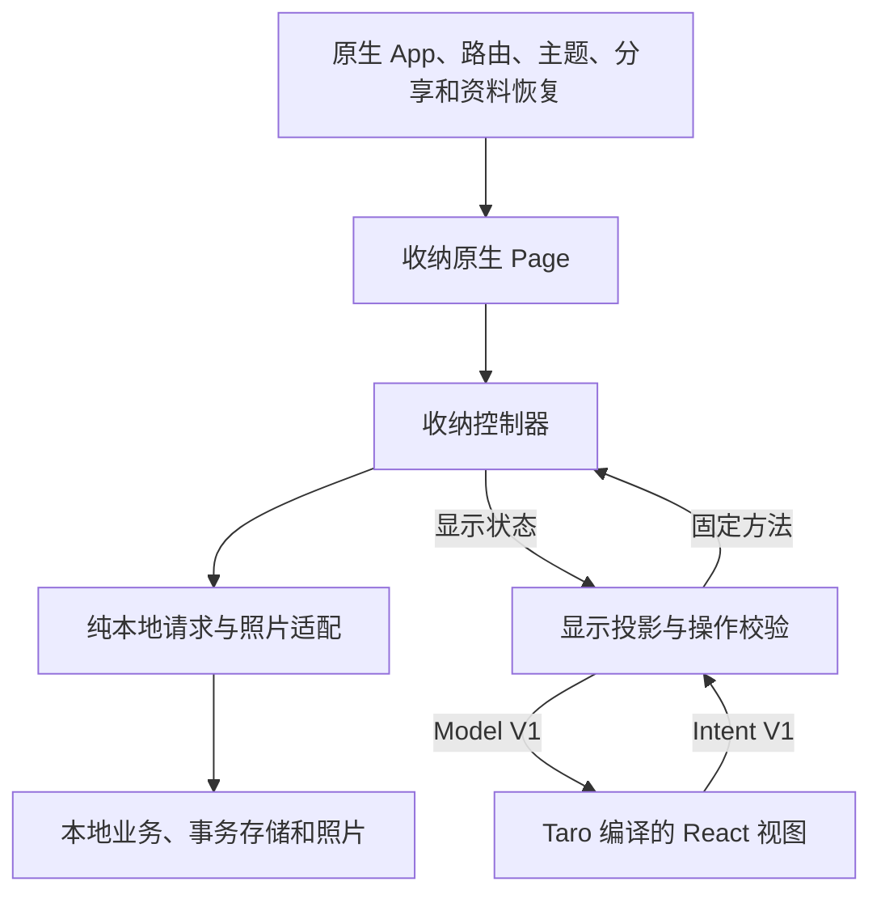

# 猫爪物账工程评估与 React 重构方案

评估日期 2026-11-27。源码基线 `5f5305b`。这是供讨论和后续分工的施工设计。线上基线为 2.0.0 纯本地版。

- [逐文件施工表和接口契约](file-contracts.md)
- [实施顺序、验收和交付](acceptance.md)
- [试点验收与实测结果](results.md)

## 1. 项目现状

项目已经有稳定的业务骨架。数据层有串行写入、分片、校验、回执和恢复版本，发布构建会裁剪云端、登录和支付入口，并校验包体。收纳位置的测试已经覆盖批量选择、版本冲突和过期响应。此前在本机记录到 579 项前端回归通过。这是有真实发布和可验证业务基础的个人项目。

目前最影响维护的是三个问题。构建依赖本机提取的压缩器，其他人拿到干净克隆时需要额外准备。部分原生页面同时承担生命周期、异步读写、可见状态和视图，修改时需要理解整页。文件选择、分享、持久化和恢复涉及微信与系统版本，现有交付记录对安卓和苹果真机仍有验证缺口。优先把这些风险变成可复现的测试和交付证据。参见[发布说明](../local-first-release.md)、[本地版实施记录](../local-first-implementation.md)与[现有收纳回归](../../tests/storage-locations.test.cjs)。

| 方面 | 成熟的程序员怎么做 | 成熟的项目设计者怎么做 | 本项目的改进 |
|---|---|---|---|
| 知识 | 掌握微信页面生命周期、分包、文件系统、TypeScript 类型与运行时校验，并能复现边界行为。 | 理清哪些是平台限制、哪些是业务承诺，给风险最大的假设安排最小验证。 | 现有本地事务与恢复规则继续由本地核心负责。混合组件的事件、样式、分包和真机文件能力各留一份证据。 |
| 思维 | 从可复现行为入手，检查取消、并发、旧数据、坏数据和异常返回。 | 以用户成本排序。用户的旧账、照片和换机恢复比换 UI 技术栈更重要。 | 固定旧版测试样本、路由、备份格式和回退方法。先做收纳位置一个试点，测过再决定扩展。 |
| 工作方法 | 做小改动，使用类型、契约测试、静态检查和独立构建复核自己的更改。 | 先指定每条接口的所有者、交付物和验收人，再将实现分配给不同 AI 或人。 | 把依赖、构建产物和发布检查固化到仓库。每次只评审一个可验证的范围，组件之间通过明确的输入与输出组合。 |
| 产品运维 | 用虚构资料复现问题，把错误和重试路径交代清楚。 | 根据恢复风险和用户影响决定发布与回退，公开信息以实际验证状态为准。 | 每次候选记录原生对照、包体、微信编译、两端真机和恢复结论。验证只用合成资料，公开日志避免带入真实账号、账目和照片。 |

行业实践在这里落成四件事。依赖和工具版本可复现，每个变更先通过自动检查，版本可回退，数据恢复有可重现证据。参考 DORA 的交付速度和稳定性方法，按版本记录从变更到可验收候选的时间、发布后补救和恢复耗时。在低频发布阶段用记录找问题。NIST SSDF 用于指导依赖、构建与发布留痕。OWASP MASVS 用于审视本机资料和用户导出的备份。完整 ZIP 默认未加密，内容可由收件方读取，哈希用于校验完整性。参见 [DORA 交付指标](https://dora.dev/guides/dora-metrics/)、[NIST SSDF](https://csrc.nist.gov/pubs/sp/800/218/final)、[OWASP MASVS 存储要求](https://mas.owasp.org/MASVS/05-MASVS-STORAGE/)。

## 2. 需求与边界

| 编号 | 需求 | 验收对应 |
|---|---|---|
| R1 | 免费、免登录，资料与照片在当前设备，代码包已下载后核心功能断网可用。保留原有物品、记账、统计、订阅／分期、小报、资料管理和分享。 | V1、V5、V6 |
| R2 | 保留 26 个页面 URL、入口和四个原生标签页。只在 `pages/storage-locations/index` 接入 React 展示，保持入口参数 `locationId`、`assignItemId` 和现有页面主题。 | V1、V2、V5 |
| R3 | 收纳可搜索、创建、改名、删除和查看物品，可多选、移动、清除位置或从物品详情直接分配。保留「未设置位置」、最多 50 件与原有确认逻辑。 | V2、V3 |
| R4 | 遇到错误、冲突、取消、快速返回或恢复到另一份资料时，页面能正确阻止过期操作。照片加载失败保持现有回退。 | V2、V3、V5 |
| R5 | 原生版本和 React 候选可各自构建。源码和最终主包均 ≤1,450,000 字节，各分包均 ≤现有 1.9 MiB 阈值。Taro/React 及其运行依赖只进入收纳分包。 | V1、V4、V5 |
| R6 | 两种产物使用同一资料目录协议与备份格式。用户能在同一 AppID 升级、读写或回退并保持资料、照片和统计。 | V5、V6 |
| R7 | AI 可根据同一份契约独立实现各文件。运行时验证和验收测试共同检查契约边界。 | V2、V3、V4 |

需求以现有纯本地功能为准。过渡云迁移、业务服务器、登录、支付、签到、奖励、H5 和全项目换框架均在本试点范围外。记账与物品的跨功能规则继续由现有本地业务层执行。收纳读法沿用现有 `GET /items`，大量物品的分页与照片调度是可独立衡量的后续改进。

## 3. 架构

| 层 | 输入 | 输出与所有权 |
|---|---|---|
| 原生应用与页面外壳 | 微信生命周期、路由参数、主题、分享事件 | 一个 App、一个收纳 Page。保持原入口和组件注册、反馈及导航行为。 |
| 收纳控制器 | 页面生命周期、白名单操作和最新资料 | 页面状态和原有业务请求。负责搜索、多选、确认、版本冲突、照片生命周期及导航。它持有原始记录和 revision。 |
| 视图契约与桥 | 控制器状态、React 操作、当前页面有效期 | 只读显示模型和已校验的一次分发。桥接代码负责格式转换，写入守卫在控制器内。 |
| React 组件 | 显示模型和操作回调 | 收纳视图及用户操作。页面数据以控制器为唯一来源。组件内部可保存纯视觉瞬态，搜索和名称以模型为准。 |
| 本地业务与存储 | 原有本地请求及照片读取 | 保持现有接口、业务规则、串行事务、备份格式与恢复。 |
| 构建与验收 | 锁定依赖、原生源码、Taro 产物 | 原生和试点各自的项目目录、内容清单、包体及兼容性检查结果。 |

React 组件只依赖契约和 Taro 展示组件。它以单向数据来维护显示一致性，操作总要经桥校验再进入控制器。控制器通过已有 `utils/api` 和照片缓存访问资料。原有 `local-core`、资料管理、收纳以外页面和正式入口都沿用现有机制。共用模块只暴露经文档确认的接口，接口变更由同一份文档和契约测试推动。

## 4. 技术选型及验证

候选选型为 Taro 4.3.3、React/React DOM 18.3.1、TypeScript 5.4.5、Webpack 5、npm 锁文件。Node 版本在第一阶段根据原生回归及 Taro 工具链的共同支持确定，放进版本文件，CI 与本机统一。依赖是否成套可装和微信是否能编译，交给最小试验确认。Webpack 5 用于这次试点，Vite 可以在后续有单独需求时再验证。参见 [Taro 4.3.3 发布记录](https://github.com/NervJS/taro/releases/tag/v4.3.3)和[该版本官方包模板](https://github.com/NervJS/taro/blob/v4.3.3/packages/taro-cli/templates/default/package.json.tmpl)。

采用 Taro 的 `native-components` 模式，把 React 视图编译成微信原生自定义组件。现有微信项目通过 `usingComponents` 引用，组件输入通过文档中的 `props` 传递。试验必须在项目原来的收纳分包里证实回调仅触发一次、带有当前页面标识、新旧模型能连续渲染、WXSS 能编译、全量组件依赖留在分包。工具链的文档说明不能替代这项实测。任一前提无法达成时保留原生版本，记录失败的生成文件及编译结果，讨论后再选路线。参见 [Taro 在原生项目内使用自定义组件的文档](https://docs.taro.zone/docs/taro-in-miniapp)。

从仓库获得源码、安装锁定工具、生成候选项目、用微信开发者工具编译，这四步分别留痕。公开项目配置继续用 `touristappid`，实际 AppID 只填入忽略跟踪的预览或发布副本。正式上传以完成验收的生成项目为入口，走现有的微信发布流程。
